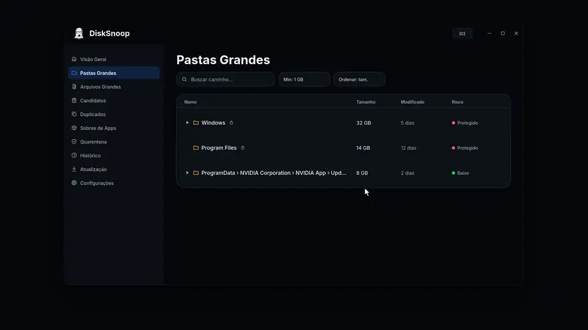

# DiskSnoop

[🇧🇷 Português (BR)](README.md) | [🇺🇸 English](README.en.md)

DiskSnoop is a Windows app for anyone who wants to see what's taking up space on an SSD or hard drive. It helps you find large files and folders and review possible cleanup items before you decide what to remove.

[Download](#download-and-installation) · [Getting started](#getting-started) · [Features](#features) · [Safety](#safety) · [Shortcuts](#keyboard-shortcuts) · [Updates](#updates) · [Limitations](#known-limitations) · [Development](#development) · [Contributing](#contributing)

## 15-second demo

[](docs/media/disksnoop-1.13.mp4)

**[▶ Watch the full HD demo (MP4)](docs/media/disksnoop-1.13.mp4)**

The demo shows the folder tree in **Large Folders** and how to browse a folder's contents.

## Download and installation

Requires Windows 10 or later (x64).

Open the [latest release](https://github.com/Fish7w7/DiskSnoop/releases/latest) and look under **Assets** for the Windows executables. Previous versions are available on [GitHub Releases](https://github.com/Fish7w7/DiskSnoop/releases).

* **Setup** — recommended for most users. Download and run `DiskSnoop-Setup-…-x64.exe`. It installs DiskSnoop for your Windows account and creates desktop and Start menu shortcuts.
* **Portable** — download and run `DiskSnoop-Portable-…-x64.exe` directly. No installation is required.

> [!NOTE]
> The executables are unsigned. Windows may show an unknown app or publisher warning when you open either build. Check that the file came from the official DiskSnoop GitHub Releases page.

## Getting started

### How to use DiskSnoop

> [!IMPORTANT]
> Scanning never deletes files automatically. A listed item may still be needed by Windows, an application, or a project. Check its path and why it was flagged before moving it.

1. **Open DiskSnoop.** Download and run Setup or Portable using the [installation instructions](#download-and-installation).
2. **Choose your language.** Use the globe selector in the top-right corner of the welcome screen to choose **Português (BR)** or **English** before your first scan.
3. **Choose what to scan.** On the welcome screen, click **Start analysis** (**Começar análise** in Portuguese). From **Overview**, use **New scan** or `Ctrl+N` to return to drive selection. To limit your next scan to specific folders, open **Settings → Scan scope** before returning to drive selection and use **Add folder** under **Included folders**. When folders are included, at least one of them must be on the selected drive.
4. **Start the scan.** On **Choose a drive**, click **Analyze C:** or the corresponding button for your drive. Watch the counters and estimated time remaining. Use **Pause**, **Resume**, or **Cancel** as needed.
5. **Read the results.** In **Overview**, check the scan duration, file count, and estimated space available for review. **Inaccessible items** shows paths the scan skipped and the reasons Windows reported. **Retry as administrator** requests Windows UAC approval for an optional read-only recheck.
6. **Find the largest items.** In **Large Folders**, use the arrows to expand the tree and select a row for details. Click **View contents** to browse subfolders. In **Large Files**, select a file to see its size and path.
7. **Review candidates and duplicates.** In **Candidates** and **App Leftovers**, review the path and the reason each item was flagged. In **Duplicates**, compare the listed copies and decide which path to keep. **Hash confirmed** indicates identical content among the verified copies. **Possible duplicate** indicates a match by name and size.
8. **Move reviewed items to quarantine.** Use **Move to quarantine** when it appears in the details panel. In **Candidates**, you can also select several eligible items and click **Move selected**. Use a quarantine folder on the same drive when moving folders.
9. **Restore an item if needed.** Open **Quarantine → Active**, select the item, and click **Restore**. DiskSnoop uses the recorded original path and stops if an item already exists there.
10. **Confirm permanent deletion.** In **Quarantine → Active**, verify the original path, click **Delete permanently**, type the word shown in the prompt, and confirm again in the native Windows dialog. DiskSnoop cannot recover items after deletion.

## What's new in 1.14.0

* Choose the language from the welcome screen or Settings. DiskSnoop uses a supported system language on first launch and remembers your choice.
* Contextual detection explains why an item appeared, where the evidence was found, and what moving it might affect.
* Quarantine revalidates items before moving them, checks the destination on restore, and asks for native confirmation before permanent deletion. The simulation and History distinguish estimated sizes from measured free-space changes.

## Features

* **Disk space analysis.** A separate process scans the chosen drive and reports progress, duration, file counts, and paths it couldn't access. You can pause or cancel the scan.
* **Large folders and files.** See where space is used, expand the folder tree, and browse contents. Details for **Large Folders**, **Large Files**, **Candidates**, **Duplicates**, and **App Leftovers** open over the current list.
* **Cleanup candidates.** Review project dependencies, build outputs, caches, old downloads and possible installers with evidence specific to each finding.
* **Duplicate detection.** DiskSnoop groups files by name and size. When hash verification is enabled, it uses SHA-256 to compare files it can read.
* **App leftovers.** DiskSnoop checks common Windows locations and considers installed apps when flagging possible leftovers.
* **Quarantine and restoration.** Move eligible items out of their original locations, restore them when needed, or explicitly confirm permanent deletion.
* **Scan history.** Reopen available saved results and track space identified for review and space freed over time. DiskSnoop also records file actions.
* **Drive health.** **Overview** displays health reported for the physical drive through Windows Storage cmdlets. Missing data appears as unavailable.
* **Customization and languages.** Choose from Light, Dark, Paper, Graphite, and System themes, and set a preset or custom accent color independently. Adjust size thresholds, detectors, included and ignored folders, and the quarantine location. The interface supports Brazilian Portuguese and English. Without a saved preference, DiskSnoop uses the primary system language when supported and falls back to English. Switch using the welcome screen selector or **Settings → Appearance → Interface language**. The change takes effect immediately and is saved for future sessions.
* **Item details.** Copy a summary with the path, size, date, category, and detection reason where available, or copy just the path. You can also verify digital signatures for supported executables and libraries.
* **Built-in update checks.** Check GitHub Releases from the app and read available release notes before updating.

## How cleanup candidates are classified

DiskSnoop combines path and directory structure with file type and evidence of a project or installation. A `dist` or `build` directory in a legitimate project still calls for review. A manifest within `node_modules` belongs to an installed dependency context. A project lockfile cannot guarantee that private or local dependencies, workspaces, or patches can be reproduced. DiskSnoop protects internal dependencies, runtimes, virtual environments, extensions, installations, and distributions managed by npm, npx, Corepack, pnpm, Yarn, or Bun. Folders containing protected components are blocked from moving as a whole.

| Risk | How to interpret it |
| --- | --- |
| Low risk | Evidence suggests the content can be recreated. Review it before moving. |
| Review recommended | Confirm the purpose, likely impact, and how to recover it. |
| High risk | The purpose or recovery options are uncertain. Review the item manually. |
| Protected | The item shows signs of active dependencies or protected content, or could not be fully verified. Moving it is blocked. |

Category, risk, and detection confidence are separate. Details and AI exports identify where evidence was observed. For example, `History` and `Preferences` in a neighboring profile help identify a Chromium cache. Verified conventional caches may be marked low risk with advice to close the app first. Shader caches, offline data, runtime downloads, and media caches call for caution. Entire profiles with persistent data are protected.

The checks recognize `Cache_Data` with the expected journal and snapshot in `No_Vary_Search`, and `Code Cache` structures in Chromium, Electron, CEF, and WebView2 profiles. Additional content with an unverified purpose calls for review. `Shared Dictionary/cache` is protected because it belongs to the same store as the metadata database in the parent directory. Use the browser's controls to clear these data.

Cleanup totals distinguish logical candidate size, potentially recoverable size, and the selection for quarantine. Equivalent paths and overlapping folders count once. Moving within the same volume keeps the files on that drive. History separates logical size deleted from changes measured in free space, which can also reflect other disk activity. The scanner does not follow symbolic links or junctions. Files with multiple hard links are excluded from eligible estimates. Compression and allocation can affect physical space recovered.

The optional AI review export includes contextual evidence, risk, confidence, and impact when available. You can import recommendations for known report IDs using `ID | APAGAR`, `ID | MANTER`, or `ID | REVISAR`. Each scan issues its own IDs, and contradictory recommendations for the same ID are ignored. Imports help filter or select eligible items. Moving files still requires user action and a fresh protection check. DiskSnoop does not require an external AI service.

## Safety

* Sensitive Windows paths may appear in disk usage results. DiskSnoop generally excludes them from cleanup candidates and blocks protected paths from cleanup actions.
* Scans leave discovered files in place. Moving an item to quarantine requires your action, and DiskSnoop keeps the original path for restoration.
* Before moving, DiskSnoop checks the current report, the on-disk identity, and protections on the path and its descendants. A folder containing protected items, links, or unverifiable content is blocked from moving as a whole. Restoration checks the destination and preserves items already there.
* Permanent deletion requires typed confirmation in the app and confirmation in a native Windows dialog. Recovered items with an unverified origin remain available for manual review. DiskSnoop may offer a Windows restore point before actions such as batch moves or permanent deletion when the feature is available.
* DiskSnoop blocks folder moves to quarantine on another drive. It can copy regular files between drives and verify the copy before removing the source.
* DiskSnoop records the original path before moving an item. Interrupted moves whose outcome is uncertain are marked **Pending move** for review. A restore may require temporary disk space when it cannot use a hard link. Concurrent external changes can interrupt an operation, including a directory deletion already in progress.
* DiskSnoop waits until scans and quarantine operations finish before applying updates. Normal updates preserve settings, history, and quarantine.

## Keyboard shortcuts

| Shortcut | Action |
| --- | --- |
| `Ctrl+N` | Open drive selection for a new scan from the main view. |
| `/` | Focus the current tab's search field, if it has one. |
| `Esc` | Close the details panel or leave the active text field. |
| `↑` / `↓` | Move through the visible items. |
| `C` | Copy the selected item's path. |

While a text field has focus, `Ctrl+N` stays available and `Esc` leaves the field. The other shortcuts in the table are inactive.

## Updates

Open **Updates → Check now** to look for new versions and read available release notes. You can also enable update checks on startup.

* **Setup** — DiskSnoop can download the update automatically if that option is enabled. Confirm **Restart to update** in the app to apply it.
* **Portable** — DiskSnoop can download the new executable. Close the old copy and run the new file manually. You can also download it from [GitHub Releases](https://github.com/Fish7w7/DiskSnoop/releases).

## Known limitations

* Locked files and paths without read permission may be skipped. An administrator recheck is read-only and requires UAC approval.
* Some paths in `ProgramData`, `Program Files`, or `Windows` may require administrator permission to read.
* Some USB and virtual drives, as well as drives behind certain storage controllers, provide no health data through Windows Storage cmdlets.
* App leftover detection is conservative and can still flag folders used by installed software.
* Concurrent disk changes can interrupt operations. If recursive deletion fails partway through, the app displays the error and records the failure in the audit log. Deletion totals in History count completed operations only.
* Cleanup evidence cannot establish whether an app is currently using a file, a runtime version is obsolete, or a build can be recreated. Possible installers in Downloads require evidence in the name or format. DiskSnoop preserves original modification dates. Dates before 1990 or significantly in the future are treated as unreliable age signals. A modification date does not indicate last use. Reports generated before the refined protection rules remain readable. Scan again before moving their items or items that have changed.
* The portable build cannot replace its executable while it is running.
* Some Windows error messages may appear in the system language.

## Development

Use Node.js 22.12 or later with npm on Windows. Run these commands from the repository root.

### Run locally

```powershell
npm install
npm run dev
```

### Run checks and tests

```powershell
npm run check
npm test
npx knip
```

Tests cover quarantine safeguards, rendered translations, AppX protection, installed-app inventory caching, Authenticode, the initial window theme, responsive detail panels, scrolling, and summaries copied for review. Review Knip findings manually because Electron, HTML, and dynamic entry points can produce false positives.

### Build for Windows

```powershell
npm ci
npm run dist -- --publish never
```

The NSIS installer and portable executable are written to `release/`. To build only the portable executable, run:

```powershell
npm run dist:portable -- --publish never
```

Setup installs into `%LOCALAPPDATA%\Programs\DiskSnoop` for the current user without requiring administrator permission.

### Publish to GitHub Releases

1. Confirm the version in `package.json`.
2. Run the checks:

   ```powershell
   npm run check
   npm test
   ```

3. Build the artifacts:

   ```powershell
   npm run dist -- --publish never
   ```

4. Create and push the matching tag:

   ```powershell
   git tag vX.Y.Z
   git push origin vX.Y.Z
   ```

5. Attach these files from `release/`:

   * `DiskSnoop-Setup-X.Y.Z-x64.exe`
   * `DiskSnoop-Setup-X.Y.Z-x64.exe.blockmap`
   * `latest.yml`
   * `DiskSnoop-Portable-X.Y.Z-x64.exe`

The installed build can update directly from an older version when the release includes the matching installer, `latest.yml`, and blockmap.

## Contributing

Before reporting a bug or suggesting a change, check for an existing discussion and open a GitHub issue if needed. For a bug report, include your DiskSnoop version, Windows version, and steps to reproduce it. [Issues](https://github.com/Fish7w7/DiskSnoop/issues)

To submit a change, fork the repository, create a branch, and run the relevant checks. Open a pull request describing the change and how you validated it. [Pull requests](https://github.com/Fish7w7/DiskSnoop/pulls)
