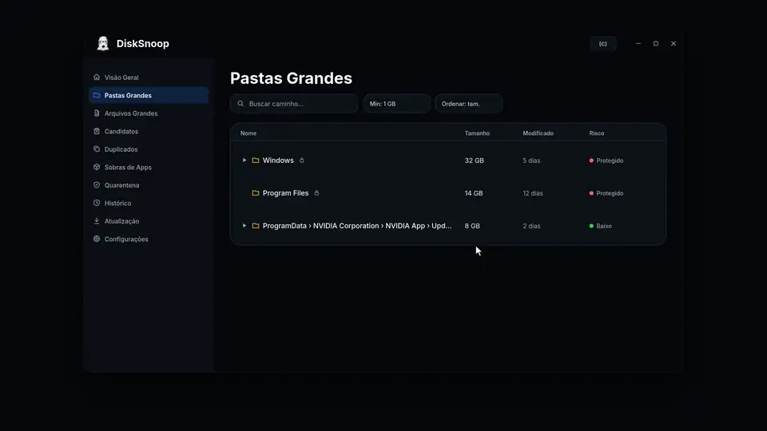

# DiskSnoop

[🇧🇷 Português (BR)](README.md) | [🇺🇸 English](README.en.md)

Aplicativo para Windows que mostra o que está ocupando espaço no SSD ou HD e permite revisar os itens antes de qualquer exclusão definitiva.

[Download](#download) · [Como usar](#como-usar-o-disksnoop) · [Recursos](#recursos) · [Segurança](#segurança) · [Atalhos](#atalhos-de-teclado) · [Atualizações](#atualizações) · [Limites](#limites-conhecidos) · [Desenvolvimento](#desenvolvimento) · [Contribuir](#como-contribuir)

## Demonstração em 15 segundos

[](docs/media/disksnoop-1.13.mp4)

**[▶ Assistir ao vídeo completo em Full HD (MP4)](docs/media/disksnoop-1.13.mp4)**

Uma apresentação rápida da tela de **Pastas Grandes** e da navegação pelo conteúdo das pastas. A prévia acima é animada; clique para abrir o vídeo original de 15 segundos.

## Download

Requer Windows 10 ou superior (x64).

Abra a [release mais recente](https://github.com/Fish7w7/DiskSnoop/releases/latest) e procure os executáveis em **Assets**. As versões anteriores estão no [GitHub Releases](https://github.com/Fish7w7/DiskSnoop/releases).

* **Setup** — opção recomendada. Baixe e execute o arquivo `DiskSnoop-Setup-…-x64.exe`. O instalador configura o aplicativo para o usuário atual e cria atalhos na Área de Trabalho e no menu Iniciar.
* **Portable** — baixe o arquivo `DiskSnoop-Portable-…-x64.exe` e execute-o diretamente, sem instalação.

> [!NOTE]
> Os executáveis não têm assinatura de código. O Windows pode exibir um aviso de aplicativo ou fornecedor desconhecido ao abrir o Setup ou o Portable. Confirme que o arquivo veio do GitHub Releases oficial do DiskSnoop.

## Como usar o DiskSnoop

> [!IMPORTANT]
> A análise não exclui arquivos automaticamente. Um item listado pode continuar sendo necessário para o Windows, um aplicativo ou um projeto. Confira a origem e o motivo da detecção antes de movê-lo.

1. **Abra o aplicativo.** Baixe e execute o Setup ou o Portable conforme as instruções de [download](#download).
2. **Escolha o idioma.** Use o seletor com ícone de globo no canto superior direito da tela de boas-vindas para escolher **Português (BR)** ou **English** antes do primeiro scan.
3. **Escolha o que analisar.** Na tela de boas-vindas, clique em **Começar análise** (**Start analysis** em inglês). Na **Visão Geral**, use **Novo scan** ou `Ctrl+N` para voltar à seleção de discos. Para limitar a próxima análise a pastas específicas, antes de abrir a seleção de discos vá a **Configurações → Escopo do scan** e use **Adicionar pasta** em **Pastas incluídas**. Se houver inclusões, o scan exige que pelo menos uma delas pertença ao disco escolhido.
4. **Inicie a análise.** Em **Escolha um disco**, clique em **Analisar C:** ou no botão equivalente do disco desejado. Acompanhe os contadores e a estimativa de tempo restante. Use **Pausar**, **Retomar** ou **Cancelar** conforme necessário.
5. **Leia o resultado.** Na **Visão Geral**, veja a duração, a contagem de arquivos e o espaço estimado para revisão. Em **Itens sem acesso**, confira os caminhos que ficaram de fora e o motivo informado pelo Windows. Se precisar, use **Tentar novamente como administrador** para uma rechecagem somente leitura, sujeita à confirmação do UAC.
6. **Investigue os maiores itens.** Em **Pastas Grandes**, expanda os ramos pelas setas e selecione uma linha para ver os detalhes. Use **Ver conteúdo** para navegar pelas subpastas. Em **Arquivos Grandes**, selecione um arquivo para conferir o tamanho e o caminho.
7. **Revise candidatos e duplicados.** Em **Candidatos** e **Sobras de Apps**, leia o caminho e o motivo da detecção. Em **Duplicados**, compare as cópias e escolha qual caminho deve ser mantido. **Hash confirmado** indica conteúdo idêntico entre as cópias verificadas. **Possível duplicado** indica correspondência por nome e tamanho.
8. **Mova apenas itens revisados para a quarentena.** Use **Mover para quarentena** quando a ação estiver disponível no painel de detalhes. Em **Candidatos**, você também pode marcar vários itens elegíveis e usar **Mover selecionados**. Use uma quarentena no mesmo disco para mover pastas.
9. **Restaure se precisar.** Abra **Quarentena → Ativos**, selecione o item e clique em **Restaurar**. O DiskSnoop usa o caminho original registrado e bloqueia a restauração se já houver um item nesse local.
10. **Confirme antes de excluir definitivamente.** Em **Quarentena → Ativos**, confira o caminho original, clique em **Excluir permanentemente**, digite a palavra solicitada e confirme também no diálogo nativo do Windows. Depois da exclusão, o DiskSnoop não consegue recuperar o item.

## Novidades da versão 1.14.0

* Escolha o idioma na tela de boas-vindas ou nas Configurações. O DiskSnoop usa um idioma compatível do sistema na primeira execução e lembra sua escolha.
* A detecção contextual explica por que um item apareceu, onde a evidência foi encontrada e o impacto de mover o item.
* A quarentena revalida os itens antes de mover, verifica o destino ao restaurar e pede confirmação nativa para excluir definitivamente. A simulação e o Histórico distinguem os tamanhos estimados da variação medida de espaço livre.

---

## O que ele faz

O DiskSnoop analisa seus discos, classifica pastas e arquivos por tamanho, explica por que cada item apareceu e move candidatos para a **quarentena** antes da remoção definitiva.

Nenhum arquivo encontrado durante a análise é excluído automaticamente.

## Recursos

### ✨ Interface e aparência

Cinco temas disponíveis: Claro, Escuro, Papel, Grafite e Sistema.

A cor de destaque pode ser escolhida separadamente do tema, entre opções prontas ou uma cor personalizada.

As telas de Pastas Grandes, Arquivos Grandes, Candidatos, Duplicados e Sobras de Apps exibem detalhes em um painel sobreposto, sem tirar o usuário da lista principal.

### 🔍 Análise de disco

O scanner funciona em um processo separado e permite acompanhar o progresso, pausar ou cancelar a análise.

Durante o scan, uma estimativa baseada na velocidade recente ajuda a indicar o tempo restante sem tratar o valor como uma previsão exata.

Os resultados incluem:

* ranking das maiores pastas;
* lista de arquivos grandes;
* duração da análise;
* quantidade de itens encontrados;
* arquivos e pastas que não puderam ser acessados.

Na Visão Geral, esses caminhos são apresentados individualmente com o motivo informado pelo Windows. Uma rechecagem opcional como administrador pode tentar apenas ler e medir os itens novamente.

Quando os cmdlets de Storage do Windows oferecem dados, a Visão Geral também mostra um indicador complementar da saúde do disco. Ausência de suporte é exibida como indisponível, nunca como saudável por padrão.

### 🧹 Limpeza inteligente

O DiskSnoop cruza caminho, estrutura, formato e evidências de projeto ou instalação. `dist` e `build` em projetos legítimos continuam sujeitos a revisão. Um manifesto dentro de `node_modules` pertence ao contexto de uma dependência instalada, e a presença de um lockfile no projeto não garante recuperar dependências privadas, locais, workspaces ou patches. Componentes de runtimes, extensões, ambientes virtuais, instalações e distribuições gerenciadas pelo npm, npx, Corepack, pnpm, Yarn ou Bun ficam protegidos. Pastas que os contêm também são bloqueadas para movimentação integral.

| Risco | Como interpretar |
| --- | --- |
| Baixo risco | Há evidências de que o conteúdo pode ser recriado. Revise antes de mover. |
| Revisão recomendada | Confirme a finalidade, o impacto e como recuperar o conteúdo. |
| Alto risco | A finalidade ou a recuperação é incerta. O item fica disponível para revisão manual. |
| Protegido | Há sinais de dependência ativa, conteúdo protegido ou uma verificação incompleta. A movimentação fica bloqueada. |

Categoria, risco e confiança aparecem separadamente. O painel e o resumo para IA identificam onde cada evidência foi observada. Por exemplo, `History` e `Preferences` no perfil vizinho ajudam a identificar um cache Chromium. Caches convencionais com estrutura verificada podem receber baixo risco e recomendação de fechar o aplicativo. Shaders, dados offline, downloads de runtimes e caches de mídia ainda exigem cautela. Perfis inteiros com dados persistentes ficam protegidos.

A verificação reconhece `Cache_Data` com o diário e o snapshot esperados em `No_Vary_Search`, além de estruturas de `Code Cache` em perfis Chromium, Electron, CEF e WebView2. Conteúdo adicional sem finalidade confirmada mantém a revisão. `Shared Dictionary/cache` fica protegido por pertencer ao mesmo armazenamento que o banco de metadados no diretório pai. Use os controles do navegador para limpar esses dados.

A simulação distingue o tamanho lógico dos candidatos, o potencialmente recuperável e a seleção para quarentena. Caminhos equivalentes e pastas sobrepostas contam uma só vez. Mover no mesmo volume mantém os dados no disco. O Histórico separa o tamanho lógico excluído da variação de espaço livre medida, que pode refletir outras atividades no disco. Links simbólicos e junctions não são seguidos, e arquivos com múltiplos hard links ficam fora dos totais elegíveis. Compressão e alocação física podem afetar o espaço efetivamente recuperado.

Arquivos duplicados são agrupados por nome e tamanho. Quando a verificação por hash está ativa, o DiskSnoop usa SHA-256 para confirmar o conteúdo dos arquivos que consegue ler.

A busca por sobras de aplicativos analisa pastas comuns do Windows com uma abordagem conservadora.

O resumo para avaliação por IA pode incluir evidências, risco, confiança e impacto. A importação continua aceitando `ID | APAGAR`, `ID | MANTER` e `ID | REVISAR` para IDs conhecidos do relatório. Cada novo scan emite IDs próprios, e respostas conflitantes para o mesmo ID são ignoradas. As recomendações ajudam a filtrar e selecionar itens elegíveis. A movimentação exige uma ação do usuário e a importação funciona sem conexão com um serviço de IA.

Essas heurísticas não confirmam se um arquivo está em uso, se uma versão de runtime é obsoleta ou se um build pode ser recriado. Em Downloads, um possível instalador precisa de indícios no nome ou formato. A data de modificação original é preservada. Datas anteriores a 1990 ou significativamente futuras são tratadas como sinais de idade não confiáveis, e o campo de modificação não representa o último uso. Relatórios gerados antes do refinamento das proteções continuam consultáveis. Para mover seus itens ou itens alterados desde a análise, faça um novo scan.

### 🗂️ Quarentena

Os itens selecionados podem ser movidos para uma quarentena antes da exclusão definitiva.

Enquanto estiverem na quarentena, os itens com origem confirmada podem ser restaurados para o local original. A exclusão permanente exige confirmação digitada no app e confirmação em um diálogo nativo do Windows. Itens recuperados sem origem confirmada ficam disponíveis para revisão manual.

Antes de mover, o DiskSnoop confere o relatório atual, a identidade do item no disco e as proteções encontradas no caminho e nos descendentes. Se uma pasta contiver um componente protegido, link ou trecho que não possa ser validado, ela não é movida integralmente. A restauração verifica o destino e mantém itens que já estejam no caminho original.

O registro com a origem é gravado antes da movimentação. Se a operação for interrompida e a conclusão estiver incerta, o item aparece como **Movimentação pendente** para revisão. Uma cópia ainda pode exigir espaço temporário quando a restauração não puder usar um hard link ou quando o arquivo for movido entre volumes. Alterações externas concorrentes podem interromper uma operação, inclusive uma exclusão de pasta já iniciada.

Para pastas grandes, é recomendado manter a quarentena no mesmo disco para evitar cópias demoradas.

### 📋 Histórico e configurações

O histórico registra análises e ações realizadas no aplicativo.

Também é possível carregar resultados anteriores e acompanhar o espaço identificado e liberado ao longo do tempo.

As configurações permitem ajustar:

* aparência;
* limites de tamanho;
* tipos de detecção;
* locais analisados;
* pastas ignoradas;
* localização da quarentena.

### 💬 Ajuda para decidir

Pastas grandes, candidatos, duplicados e sobras de aplicativos permitem copiar um resumo com informações como caminho, tamanho, data, categoria e motivo da detecção.

Isso facilita pesquisar ou pedir ajuda antes de remover um item desconhecido.

O botão de copiar caminho mantém essa ação separada: ele envia para a área de transferência somente o caminho puro do arquivo ou pasta.

Executáveis e bibliotecas compatíveis também podem ter a assinatura digital verificada.

### 🌐 Idiomas

A interface está disponível em português do Brasil e inglês. Sem uma preferência salva, o DiskSnoop usa o idioma principal do sistema quando compatível e recorre ao inglês nos demais casos. A troca pode ser feita pelo seletor na tela de boas-vindas ou em **Configurações → Aparência → Idioma da interface**. A nova escolha é aplicada na hora e salva para as próximas sessões.

## Atalhos de teclado

* `Ctrl+N` — abrir a seleção de discos para um novo scan a partir da tela principal;
* `/` — focar a busca da tela atual;
* `Esc` — fechar o painel de detalhes ou tirar o foco do campo de texto;
* `↑` e `↓` — navegar pelos itens visíveis;
* `C` — copiar o caminho do item selecionado.

Quando um campo de texto está em foco, `Ctrl+N` continua disponível e `Esc` tira o foco do campo. Os demais atalhos da lista ficam desativados nesse contexto.

## Atualizações

Em **Atualização**, clique em **Verificar agora** para buscar novas versões no GitHub Releases e consultar as notas disponíveis. Você também pode habilitar a verificação ao iniciar.

* **Setup** — o aplicativo pode baixar a atualização automaticamente se essa opção estiver habilitada. Para aplicar a atualização, confirme o reinício no aplicativo.
* **Portable** — o aplicativo pode baixar o novo executável. Feche a versão antiga e execute o novo arquivo manualmente. Você também pode baixá-lo no [GitHub Releases](https://github.com/Fish7w7/DiskSnoop/releases).

## Segurança

* Arquivos e pastas sensíveis do Windows podem aparecer no mapa de uso, mas não entram normalmente como candidatos de limpeza.
* Nenhum item detectado pela análise é excluído automaticamente.
* A exclusão permanente sempre exige uma ação explícita do usuário.
* Itens movidos para a quarentena mantêm as informações necessárias para restauração.
* Ações como mover itens em lote ou excluir permanentemente podem oferecer a criação de um ponto de restauração do Windows quando o recurso estiver disponível.
* Atualizações não são aplicadas durante uma análise ou enquanto ações de quarentena estão em andamento.
* Configurações, histórico e quarentena não são removidos durante atualizações normais do aplicativo.

> [!NOTE]
> O DiskSnoop bloqueia a movimentação de pastas para uma quarentena em outro disco. Arquivos comuns podem ser copiados entre discos, com verificação antes da remoção da origem.

## Limites conhecidos

* Arquivos bloqueados ou sem permissão podem não ser analisados completamente; a rechecagem elevada depende de confirmação no UAC e continua sendo somente leitura.
* Alguns discos USB, virtuais ou controladores específicos não fornecem dados de saúde pelos cmdlets de Storage.
* Algumas pastas em `ProgramData`, `Program Files` ou `Windows` podem exigir permissão de administrador.
* A detecção de sobras de aplicativos é conservadora e pode mostrar pastas que ainda pertencem a programas instalados.
* Alterações concorrentes no disco podem interromper operações. Se uma exclusão recursiva falhar no meio, o aplicativo exibe o erro e registra a falha no log de auditoria. Os totais de exclusão do Histórico só contabilizam operações concluídas.
* A versão portable não consegue substituir automaticamente o executável enquanto ele estiver aberto.
* Algumas mensagens de erro do Windows podem aparecer no idioma original do sistema.

---

## Desenvolvimento

### Rodar localmente

Use o Node.js 22.12 ou superior com npm no Windows. Execute os comandos na raiz do repositório.

```powershell
npm install
npm run dev
```

### Validar

```powershell
npm run check
npm test
npx knip
```

Os testes cobrem regras críticas de quarentena e a camada de tradução renderizada para evitar textos em Português quando a interface está em Inglês.

O Knip audita arquivos, exports e dependências sem uso. O relatório deve ser revisado manualmente, pois entradas carregadas pelo Electron, pelo HTML ou por ações dinâmicas podem gerar falsos positivos.

Também há regressões para proteção AppX, cache do inventário, Authenticode, tema do primeiro frame, overlays responsivos, scroll e textos copiados para tirar dúvidas.

### Build para Windows

```powershell
npm ci
npm run dist -- --publish never
```

O instalador NSIS e o portable serão gerados em `release/`.

Para gerar apenas o portable:

```powershell
npm run dist:portable -- --publish never
```

O instalador é colocado em `%LOCALAPPDATA%\Programs\DiskSnoop` para o usuário atual, sem exigir permissão de administrador.

### Publicar no GitHub Releases

1. Confirme a versão em `package.json`.

2. Rode as validações:

   ```powershell
   npm run check
   npm test
   ```

3. Gere os artefatos:

   ```powershell
   npm run dist -- --publish never
   ```

4. Crie e envie a tag:

   ```powershell
   git tag vX.Y.Z
   git push origin vX.Y.Z
   ```

5. Anexe os seguintes arquivos da pasta `release/`:

   * `DiskSnoop-Setup-X.Y.Z-x64.exe`
   * `DiskSnoop-Setup-X.Y.Z-x64.exe.blockmap`
   * `latest.yml`
   * `DiskSnoop-Portable-X.Y.Z-x64.exe`

> O `electron-updater` pode atualizar diretamente de uma versão antiga para a mais recente, desde que a release inclua o instalador, o `latest.yml` e o `.blockmap` correspondentes.

## Como contribuir

Para relatar um erro ou sugerir uma melhoria, procure relatos semelhantes e abra uma [Issue](https://github.com/Fish7w7/DiskSnoop/issues). Ao relatar um erro, inclua a versão do DiskSnoop, a versão do Windows e os passos para reproduzi-lo.

Para enviar uma alteração, faça um fork, crie uma branch, rode as verificações pertinentes e abra um [Pull Request](https://github.com/Fish7w7/DiskSnoop/pulls) descrevendo a mudança e como você a validou.
